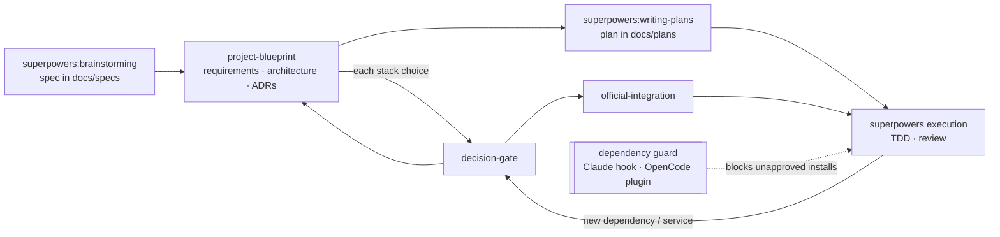

# senior-standards

A language-neutral plugin for Claude Code and OpenCode v2, layered on [Superpowers](https://github.com/obra/superpowers). It adds senior-engineer process rules: a decision gate before any dependency or service is chosen, ADRs as the record, project documentation before the plan, and a guard that stops unapproved dependency installs.

No Superpowers file is modified. The plugin injects a short standards text at session start (specs in `docs/specs/`, plans in `docs/plans/`, run `project-blueprint` between an approved spec and `writing-plans`) and ships six skills.



## Skills

| Skill | Use |
| :- | :- |
| `project-blueprint` | After an approved spec: requirements, architecture docs, ADRs and project memory (`AGENTS.md`) before the plan. |
| `decision-gate` | Before adding or choosing a dependency, service, database, host or paid API: compare options, ask in chat, then record. |
| `adr` | Create, supersede and index ADRs in `docs/adr`. |
| `official-integration` | Install an accepted choice the vendor's way, including its official MCP server and Agent Skills. |
| `repo-standards` | Bring a repository to standard: formatter, linter, tests, CI, dependency hygiene, one check command. |
| `audit` | Read-only gap report of a repository against those standards. |

In Claude Code they are also available as `senior-standards:<name>`.

## Dependency guard

The guard inspects tool calls that could add a dependency and asks before one that no accepted ADR covers. It never grants permission: the result is either no output (the harness's normal permission flow continues) or an `ask`.

**Gated**
- Shell commands that add a direct dependency or install a tool: `npm|pnpm|yarn|bun|deno add/install`, `dotnet add package`, `dotnet tool install`, `cargo add|install`, `pip install`, `uv add`, `poetry add`, `pipx install`, `go get|install`, `composer require`, `bundle add`, `gem install`, `dart|flutter pub add`. An install with a package argument is gated; a bare install or restore from the lockfile is not. Chained commands are split.
- File edits that add a name to a supported manifest (`package.json`, `*.csproj`, `Cargo.toml`, `go.mod`, `pyproject.toml`, `requirements*.txt`, `pom.xml`, Gradle files, `Gemfile`, `pubspec.yaml`, `composer.json`, and others). Any edit to a fixed list of other manifests (`Package.swift`, `mix.exs`, `Podfile`, ...) asks.

**Not gated**: restores from an existing lockfile (`npm ci`, `pnpm install`, `dotnet restore`, `pip install -r`), removals, one-off runs (`npx`, `pnpm dlx`, `uvx`), version bumps, reordering, internal references (`workspace:`, `path =`, `ProjectReference`).

**Approving packages**: an ADR in `docs/adr/` with `status: accepted` approves the names in its `packages:` list. Names match exactly, except that NuGet names ignore case, Python names are compared PEP 503-normalised, and Cargo treats `-` and `_` as the same.

```yaml
---
status: accepted
date: 2026-10-21
packages: [better-auth]
---
```

Any other status approves nothing. Internal guard errors also resolve to `ask`.

### AI-attribution check

The always-on standards tell the agent never to add AI attribution (co-author trailers, "Generated with …" footers, mentions of the assistant, the coding tool or the model) to commits, PRs, issues, comments, docs or changelogs. The guard backs this up: a shell command that runs `git commit`, `git tag`, `git merge`, `git notes add`, `gh pr create|edit|comment|review|merge` or `gh issue create|edit|comment` asks when its text (including `-m`/`--body` values, heredoc bodies and files passed with `-F`/`--file`/`--body-file`) contains:

- a `Co-Authored-By:` trailer naming an AI assistant, tool, vendor or model (Claude, Anthropic, OpenCode, OpenAI, ChatGPT, Copilot, Gemini, Codex, Cursor and similar);
- a phrase such as "Generated with", "Created by", "Assisted by", "Built with" followed on the same line by one of those names, or a `🤖 Generated …` footer;
- a model identifier such as `claude-opus-…`, `gpt-4…`, `gemini-2…`, `llama3`.

The reason lists the matches. Approve to proceed anyway.

**Prompts**
- Claude Code: a `PreToolUse` hook on `Bash`, `PowerShell`, `Edit` and `Write` returns `ask`, so Claude Code shows its usual permission prompt with the reason. If the hook itself fails, the tool call is blocked (`onFailure: "block"`).
- OpenCode: the plugin forces OpenCode's native approval prompt (`Allow once` / `Reject`) for the action `senior-standards.dependency`. The compact prompt shows only the action name and the resources, so the agent also names the packages in chat. The AI-attribution check uses the same action with the resource `ai-attribution`. Non-interactive `opencode run` rejects the call. `opencode run --auto` auto-approves the guard's prompt without showing it; that is your explicit choice to auto-approve. See [ADR 0003](docs/adr/0003-opencode-guard-mechanism.md).

## Requirements

- Superpowers installed in each harness you use (it is not declared as a dependency because it comes from different sources in each).
- Claude Code >= 2.1.295 (for the hook's `onFailure: "block"`), with Node >= 22 on `PATH` (the hooks run `node`).
- OpenCode >= 2.0.29 (v2 only); verified on 2.1.2.

## Install

### Claude Code

```bash
claude plugin marketplace add titanfrigel/senior-standards
claude plugin install senior-standards@senior-standards
```

A private repository works through your existing Git credentials.

### OpenCode v2

Add to `opencode.json`:

```json
{ "plugins": ["senior-standards@git+https://github.com/titanfrigel/senior-standards.git#v0.1.0"] }
```

For a private repository, Bun and npm need Git credentials: SSH, or a credential helper.

On Windows, OpenCode's Bun-based git installs can fail. Fallback: install with npm, then reference the absolute path.

```powershell
npm install "senior-standards@git+https://github.com/titanfrigel/senior-standards.git#v0.1.0" --prefix "$HOME\.config\opencode"
```

```json
{ "plugins": ["C:\\Users\\<you>\\.config\\opencode\\node_modules\\senior-standards"] }
```

### Recommended: Context7 (optional)

Context7 serves version-specific library docs for libraries without their own docs MCP. Use its official installer; `official-integration` uses it when present.

```bash
npx ctx7 setup --claude
npx ctx7 setup --opencode
```

## Manual verification

Behavioural evals cover Claude Code (see [CONTRIBUTING.md](CONTRIBUTING.md)); OpenCode has no runner, so run these in a throwaway project in each harness.

**A. Next.js app with auth**
1. Blueprint docs are produced before any code.
2. Auth goes through the decision gate with Better Auth compared; an ADR is written.
3. `pnpm add better-auth` passes after the ADR; `pnpm add lodash` prompts.
4. Better Auth MCP server and skills are proposed for both harnesses, not silently added.

**B. .NET Web API**
1. Adding a database goes through the decision gate (for example PostgreSQL vs SQL Server vs SQLite, EF Core vs Dapper).
2. An edit adding a `PackageReference` not covered by an ADR prompts.
3. An unrelated `.csproj` edit does not.

**C. Rust CLI**
1. Adding logging compares `tracing` and `log`-based options.
2. `cargo add` of an uncovered crate prompts.
3. `repo-standards` proposes the Rust checklist with toolchain pin, clippy and cargo-deny verified against current docs.

## Uninstall

Claude Code:

```bash
claude plugin uninstall senior-standards@senior-standards
claude plugin marketplace remove senior-standards
```

OpenCode: remove the entry from `plugins` in `opencode.json`; if you used the Windows fallback, also run `npm uninstall senior-standards --prefix "$HOME\.config\opencode"`.

## Status and limitations

Version 0.1.0. Open verification items are listed in ADR 0003, [Not yet verified](docs/adr/0003-opencode-guard-mechanism.md#not-yet-verified): a human keypress on the OpenCode approval prompt, the expanded prompt view, and OpenCode field names before 2.1.2. Behavioural eval scores have not been recorded yet. Released under the [MIT licence](LICENSE).

What the guard does not cover:

- Manifests written through the shell (`sed -i`, `echo … >> requirements.txt`, `Set-Content`): only the harness's own edit and write tools are checked against manifests.
- Commands hidden inside another command: `bash -c "…"`, `cmd /c …`, `pwsh -c …`, subshells `( … )` and command substitution `$( … )`.
- npm aliases: `zod@npm:other-package` is reported, and matched against ADRs, as `zod`.
- One-off runners (`npx`, `pnpm dlx`, `bunx`, `uvx`) are not gated, by design.
- Claude Code `bypassPermissions`: not verified; the hooks reference does not say whether a hook's `ask` still prompts in that mode. In `claude -p` runs nobody can answer the prompt, so the call is not run.
- AI-attribution check: bare product mentions (`fix(claude): adapter`, `support Claude Code hooks`) are not flagged, since this repository legitimately has them. Only the commit or PR command itself is scanned (plus its heredoc or here-string body, and the whole command when it reads a variable or piped stdin); at most the first 64 KB of each text and 1 MB of each `-F`/`--body-file` file are checked, and device paths and stdin files are never read. Commits authored in an editor or through other tools, text built by other commands and fed in indirectly (for example `$(cat file)` or `git commit -F <(…)`), commands hidden inside `bash -c`, and edits made in the GitHub web UI are not seen. A co-author trailer naming only a first name that is also a product (`Claude`, `Devin`, `Cursor`) is flagged only without a personal-looking address.
- OpenCode `--auto` auto-approves the guard's prompt without showing it ([ADR 0003](docs/adr/0003-opencode-guard-mechanism.md)).
- OpenCode subagent sessions do not get the injected standards.
