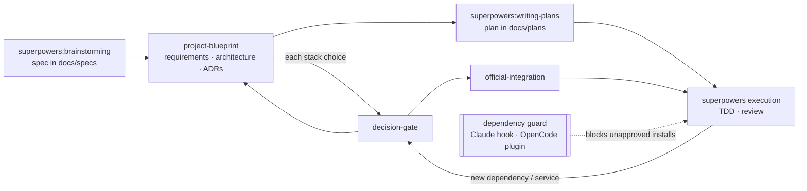

# senior-standards — Design

- **Status:** Approved v3.1 (2026-10-21). v3.1: OpenCode v2 only; Context7 installed through its official setup instead of bundled.
- **Date:** 2026-10-21
- **Author:** kling.gaetan@gmail.com (with Claude)
- **Type:** Plugin for **Claude Code** and **OpenCode**, companion to Superpowers v6.4.x

## 1. Intent

### What the user asked for
- A clear plan before each project, with written documentation of the product, the architecture and the decisions.
- Use established libraries instead of hand-rolled code (example: Better Auth for auth), and pull in the vendor's MCP servers and Agent Skills.
- Always ask before introducing a dependency, service, database, hosting provider or paid API, with the options, their differences and benefits laid out.
- Always install the vendor's official way (documented command, official CLI, official skill or MCP).
- Clean repositories, good documentation, best practices, best architecture. The user is a senior developer: output should be dense and precise, not tutorial-style.
- **Works in both Claude Code and OpenCode,** with the same skills and the same guarantees.

### Assumptions
- **A1.** Superpowers stays installed in each harness and keeps owning the process (brainstorming → spec → writing-plans → TDD → review). Superpowers already supports both harnesses. This plugin adds rules and steps; it does not replace any Superpowers skill.
- **A2.** The primary stack is TypeScript/Node. Other ecosystems get the decision gate and the install guard, but no repo-standards profile in v1.
- **A3.** The user works on Windows. All plugin code runs cross-platform on Node built-ins (Claude Code hooks run under Node; OpenCode plugins run under Bun, which supports the same built-ins).
- **A4.** "Always ask" applies to direct runtime and dev dependencies, external services, databases, hosting and paid APIs. It does not apply to transitive dependencies or to reinstalling from an existing lockfile.
- **A5.** OpenCode **v2 only** (≥ 2.0.29, where `setup(ctx)` exposes tool hooks). OpenCode v1 is not supported.

### Success criteria
1. On a new project, no product code or install happens before `requirements.md`, `architecture/overview.md` and the ADRs for every stack choice exist and the user has approved them.
2. Every new direct dependency is either covered by an accepted ADR or triggers a confirmation prompt, even when the model forgets the skill — in both harnesses.
3. Every choice of service, DB, host or paid API is presented as a comparison of 2–4 options with a recommendation, then recorded as an ADR.
4. Every install uses the command from the vendor's current docs, and the vendor's MCP server and skills (when they exist) are proposed at project scope, for every harness the project uses.
5. Upgrading Superpowers, Claude Code or OpenCode does not silently break any of the above (automated checks, §12).

## 2. Non-goals
- Replacing or forking any Superpowers skill.
- Detecting service, DB or hosting choices mechanically. Those are enforced by the skill and the session rules only, since no tool call reliably signals them.
- Gating `npx`/`pnpm dlx`/`bunx` one-off executions in v1 (official scaffolders and CLIs run this way).
- Stack profiles other than TypeScript/Node in v1.
- Harnesses other than Claude Code and OpenCode (Codex, Cursor, Gemini…). The core/adapter split (§4) keeps them possible later.
- Publishing to a public marketplace or registry.

## 3. Approach

One repository, one **harness-agnostic core** (skills, standards text, guard logic), and one thin **adapter per harness**. The repository is at the same time a Claude Code marketplace and an OpenCode plugin package. It is hosted as a **private GitHub repository**.

This is the pattern Superpowers itself uses to support several harnesses from one repo, so it is proven against both hosts.

Rejected alternatives:
- **Fork Superpowers:** every upstream release needs a manual merge.
- **Global `~/.claude/CLAUDE.md` / `AGENTS.md` only:** no enforcement, rules diluted in long sessions, no templates or hooks.
- **Two separate plugins (one per harness):** duplicated skills drift apart.

## 4. Architecture

### 4.1 Repository layout

```text
senior-standards/                      # private GitHub repo
├── .claude-plugin/
│   ├── marketplace.json               # Claude marketplace: one entry → ./ (this repo)
│   └── plugin.json                    # Claude plugin manifest
├── hooks/
│   └── hooks.json                     # Claude adapter registration
├── adapters/
│   ├── claude/
│   │   ├── session-start.mjs          # emits standards as additionalContext
│   │   └── pre-tool-use.mjs           # stdin JSON → core.evaluate → hook JSON
│   └── opencode/
│       └── plugin.mjs                 # OpenCode v2 default export {id, setup}
├── index.js                           # OpenCode package entry → adapters/opencode/plugin.mjs
├── package.json                       # name, version, type: module, exports; zero dependencies
├── core/                              # pure, harness-agnostic, unit-tested
│   ├── standards.md                   # always-on rules (§5)
│   ├── evaluate.mjs                   # normalised tool call → {decision, reason}
│   ├── normalize.mjs                  # harness tool names/args → {kind, command | file, before, after | patch}
│   ├── parse-install.mjs              # command → {manager, packages[]}
│   ├── diff-manifest.mjs              # package.json before/after → added deps
│   └── adr-index.mjs                  # docs/adr/*.md → approved package set
├── skills/                            # shared by both harnesses (Agent Skills format)
│   ├── project-blueprint/{SKILL.md, templates/}
│   ├── decision-gate/SKILL.md
│   ├── official-integration/SKILL.md
│   ├── repo-standards/{SKILL.md, profiles/typescript-node.md}
│   ├── audit/SKILL.md                 # P1
│   └── adr/SKILL.md                   # P2
├── tests/
│   ├── core/                          # node:test, zero dependencies
│   ├── adapters/                      # hook/plugin contract tests with fixtures per harness/version
│   └── evals/                         # claude plugin eval cases (P3)
├── docs/{specs/, plans/, adr/}
├── README.md, CHANGELOG.md, LICENSE, SECURITY.md
└── .github/workflows/ci.yml
```

Placing the Claude manifest at the repo root (marketplace entry `source: "./"`) lets one directory serve both harnesses: Claude reads `.claude-plugin/`, `skills/`, `hooks/`; OpenCode reads `package.json` → `index.js`. Neither harness loads the other's files.

The plugin has **zero runtime dependencies**: Node/Bun built-ins only.

### 4.2 Components

| Unit | Responsibility | Depends on |
|---|---|---|
| `core/standards.md` | The always-on rules (§5). Under ~60 lines. | — |
| `core/normalize.mjs` | Maps each harness's tool call to one shape. Claude: `Bash`, `Edit`, `Write`. OpenCode v2: `shell`, `edit`, `write`, `patch`. | — |
| `core/evaluate.mjs` | Normalised call + project dir → `{decision: "pass" \| "ask", reason}` (§6). | `parse-install`, `diff-manifest`, `adr-index` |
| `adapters/claude/*` | SessionStart → `additionalContext`; PreToolUse → `permissionDecision: "ask"`. | `core/*` |
| `adapters/opencode/plugin.mjs` | Registers `skills/`, injects standards into session context, guards tool calls (§6.5). | `core/*` |
| `project-blueprint` | Produces the project documentation set (§7). | `decision-gate` |
| `decision-gate` | Comparison → recommendation → user choice → ADR (§8). | — |
| `official-integration` | Official docs lookup, official install, vendor MCP/skills proposal for each harness (§9). | — |
| `repo-standards` | Applies the TS/Node baseline and core practices as one bundled decision (§10, §15). | `decision-gate` |
| `audit` | Gap report of an existing repo against these standards; changes nothing without approval (P1). | — |
| `adr` | Create, supersede and reindex ADRs (P2). | — |

### 4.3 How it plugs into Superpowers



Superpowers' skills state that user preferences override default locations and steps, so `standards.md` states, as user preferences:
- Specs go to `docs/specs/`, plans to `docs/plans/`.
- On the architectural path, after the spec is approved and before invoking writing-plans, run the `project-blueprint` skill.

No Superpowers file is modified, in either harness.

### 4.4 Skills portability rules
Skills are shared verbatim, so they follow the stricter of the two formats:
- Frontmatter: `name` (lowercase, single hyphens, ≤ 64 chars, equal to the folder name) and `description` (≤ 1024 chars). No harness-specific frontmatter keys.
- Body text names actions, not tools: "ask the user with the harness's structured-question tool if it has one, otherwise in chat"; "fetch the URL"; "run the command". This is the convention Superpowers uses.
- Skill cross-references use the bare skill name (`decision-gate`), which both harnesses resolve. Claude namespaces plugin skills as `senior-standards:decision-gate`; `standards.md` notes both forms.

## 5. Always-on standards (`core/standards.md`)

Injected by the Claude SessionStart hook and by the OpenCode session context hook. Content outline:
1. **Decision rule.** Never introduce a dependency, external service, database, hosting provider or paid API without the `decision-gate` skill. Applies to existing repos too.
2. **Prefer established libraries.** Before writing infrastructure code (auth, payments, email, queues, validation, ORM, date handling, i18n…), check for a mature library and present it through the decision gate. Custom code is one option, never the silent default.
3. **Official installation only.** Installs follow `official-integration`. No hand-edited dependency versions in manifests; the package manager writes them.
4. **Documentation locations** (§4.3) and the blueprint step.
5. **Repo hygiene:** Conventional Commits; small, single-purpose modules; no dead code, commented-out code or stray TODOs; docs updated in the same change as the code; ADRs append-only.
6. **Project memory:** `AGENTS.md` is the single source; `CLAUDE.md` only contains `@AGENTS.md` so Claude Code imports it (OpenCode reads `AGENTS.md` natively).
7. **Communication:** the user is a senior developer. Be concise, give trade-offs and reasoning, skip basics.

## 6. Dependency guard

### 6.1 Detection (core, shared)

**Shell commands:** `parse-install` recognises the commands that add a direct dependency, and extracts package names (stripping version specifiers and flags):

| Manager | Commands |
|---|---|
| npm | `npm install\|i\|add <pkg…>` |
| pnpm | `pnpm add <pkg…>` |
| yarn | `yarn add <pkg…>` |
| bun | `bun add <pkg…>` |
| Python | `pip install <pkg…>` (not `-r`/`-e .`), `uv add`, `poetry add` |
| Rust / Go / PHP / .NET | `cargo add`, `go get`, `composer require`, `dotnet add package` |

Not gated: lockfile installs with no package arguments (`npm install`, `pnpm install`, `npm ci`…), removals, and `npx`-style one-off runs. Chained commands (`&&`, `;`, `|`) are split and each segment checked.

**File edits:**
- `package.json` via Write/Edit: rebuild the post-edit file, diff the four dependency sections, gate added names.
- `package.json` via a patch tool (OpenCode `patch`): patches can't be rebuilt reliably, so any patch touching `package.json` dependency sections → `ask`.
- Other manifests (`pyproject.toml`, `Cargo.toml`, `go.mod`…): `ask` whenever an edit touches them.

### 6.2 Approval source

`adr-index` reads `docs/adr/*.md` and collects the `packages` list from every ADR with `status: accepted`:

```yaml
---
status: accepted          # proposed | accepted | superseded | rejected
date: 2026-10-21
packages: [better-auth]   # exact names the decision approves; may be empty
---
```

### 6.3 Decision (core, shared)
- Every detected package approved → `pass`: the harness's normal permission flow continues. The guard never grants permission.
- Otherwise → `ask`, with a reason such as `New dependency not covered by an accepted ADR: zod, date-fns. Run the decision gate first, or approve to proceed anyway.`
- Internal error → `ask` with the error in the reason. Fail closed, but the user always keeps the final word.

### 6.4 Claude Code adapter

`hooks/hooks.json`, exec form so no shell or quoting is involved:

```json
{
  "hooks": {
    "SessionStart": [{ "matcher": "startup|clear|compact",
      "hooks": [{ "type": "command", "command": "node", "args": ["${CLAUDE_PLUGIN_ROOT}/adapters/claude/session-start.mjs"] }] }],
    "PreToolUse": [{ "matcher": "Bash|Edit|Write",
      "hooks": [{ "type": "command", "command": "node", "args": ["${CLAUDE_PLUGIN_ROOT}/adapters/claude/pre-tool-use.mjs"] }] }]
  }
}
```

`ask` maps to `hookSpecificOutput.permissionDecision: "ask"` with `permissionDecisionReason`; `pass` prints nothing. Exact exec-form field names are verified against the hooks reference during implementation.

### 6.5 OpenCode adapter

A plain default export `{ id: "senior-standards", setup }` with no dependency on `@opencode/plugin` (Superpowers ships the same shape and loads on v2):

| Capability | OpenCode v2 |
|---|---|
| Register `skills/` | `ctx.skill.transform` → `editor.add(...)` per skill, each in its own try/catch |
| Inject `standards.md` | `ctx.session.hook("context")` → `event.system.push(...)`, top-level sessions only (skip subagent sessions via `parentID`) |
| Guard | `ctx.tool.hook("execute.before")` → `evaluate`; on `ask`, `ctx.permission.assert` with action `senior-standards.dependency` and the uncovered packages as resources, so the user gets OpenCode's normal approval prompt; a rejection propagates and stops the call |

If a spike on a real OpenCode build shows `ctx.permission.assert` can't produce a prompt from this hook, the guard throws an error carrying the reason instead (the documented blocking pattern), and the agent must get approval in chat and record the ADR. The spike's result is recorded in an ADR.

Any adapter error is caught and logged; it never disables the plugin (Superpowers documents that an escaping error in `setup` disables the whole plugin generation).

## 7. `project-blueprint` skill

Produces, from templates, only what is missing:

| File | Content |
|---|---|
| `README.md` | Purpose, quick start, scripts, links into `docs/`. |
| `docs/product/requirements.md` | Problem, users, goals, **non-goals**, functional and non-functional requirements, constraints, success metrics. |
| `docs/architecture/overview.md` | arc42-lite: context (C4 L1, Mermaid), building blocks (C4 L2), runtime flows, deployment, cross-cutting concerns, quality goals, **threat model** (S4), risks and technical debt, **layer rules** enforced in CI (A1). |
| `docs/adr/0001-record-architecture-decisions.md` | Bootstraps the ADR log. MADR format plus §6.2 frontmatter. |
| `docs/adr/NNNN-*.md` | One per stack decision, written by `decision-gate`. |
| `docs/adr/README.md` | Generated index (C2). |
| `CONTRIBUTING.md` | Branching, commit convention, checks, how to add an ADR. |
| `AGENTS.md` + `CLAUDE.md` | Project memory for both harnesses (§5.6): stack, commands, layout, links. |
| `SECURITY.md` | Reporting policy (S4). |

Flow: read the approved spec → draft `requirements.md`, get approval → run `decision-gate` for each stack decision → draft `architecture/overview.md`, get approval → write the rest, commit `docs: project blueprint` → hand off to writing-plans.

Existing repos: only on request, and only fills missing documents.

## 8. `decision-gate` skill

1. **Frame the decision:** need, constraints from `requirements.md`, category.
2. **Research current facts** from official sources. No pricing or maturity claims from memory.
3. **Present 2–4 options** in a table ("build it ourselves" only when realistic):

   | Criterion | Option A | Option B | … |
   |---|---|---|---|
   | Fit for the requirements | | | |
   | Maturity and maintenance | | | |
   | **Package health** (D6): last publish, maintainers, provenance / trusted publishing, weekly downloads, open advisories | | | |
   | License | | | |
   | Cost now and at scale | | | |
   | Lock-in and exit cost | | | |
   | Security and compliance posture | | | |
   | DX and type safety | | | |
   | Official AI tooling (MCP server, skills, llms.txt) | | | |

4. **Recommend one option,** then ask, recommended option first.
5. **Write the ADR** after the answer, with `packages:` filled in; rejected options recorded under "Considered options".
6. Hand off to `official-integration`.

Tightly coupled choices can be one decision and one ADR (e.g. the repo baseline, §10).

## 9. `official-integration` skill

1. **Find the official source,** in order: the vendor's docs MCP → the vendor's `llms.txt` → Context7 → the vendor's docs pages via web fetch.
2. **Install with the documented command,** translated to the project's package manager (e.g. `pnpm add better-auth`; the package is `better-auth`, not `betterauth`). Names are checked against the docs, never guessed.
3. **Run the vendor's official CLI or generators** where the docs prescribe them, rather than hand-writing their output.
4. **Vendor AI tooling:** check for an official MCP server and Agent Skills (example: Better Auth documents a docs MCP at `https://mcp.better-auth.com/mcp` and publishes skills at `/docs/ai-resources/skills`). Propose adding them **at project scope for each harness the project uses**:
   - MCP: `.mcp.json` (Claude Code) and the `mcp` key of `opencode.json` (OpenCode: `type: "remote"` + `url`, or `type: "local"` + `command` array).
   - Skills: `.claude/skills/<name>/` — OpenCode also discovers this path, so one copy serves both. Installed with the vendor's documented method.
   This changes persistent config, so it is always a question, never automatic.
5. **Record:** link the docs page and any MCP/skill added in the ADR; list project MCP servers in `AGENTS.md`.

## 10. `repo-standards` skill (TypeScript/Node profile)

One bundled decision, one ADR. Accepted defaults (2026-10-21), re-checked against current releases each time the skill runs:

| Concern | Default | Main alternative |
|---|---|---|
| Package manager | **pnpm** (§16.3) | npm, bun |
| Language | TypeScript `strict`, `noUncheckedIndexedAccess` | — |
| Lint + format | **Biome**; ESLint (lint only) added just for a plugin Biome lacks (§16.2) | ESLint + Prettier |
| Tests | Vitest | node:test |
| Git hooks | lefthook + commitlint | husky |
| Releases | Chosen per project (V3) | — |
| Env config | Typed, validated env module (zod) | t3-env |
| CI | GitHub Actions running `pnpm check` + build | — |
| Dependency updates | Renovate (D1) | Dependabot |

Plus every **core** practice in §15. Architecture style (feature-sliced, layered, hexagonal) is chosen in `project-blueprint`, not here.

## 11. Error handling
- Adapters never throw into the host except the guard fallback throw (§6.5). All other errors become `ask` (guard) or a logged warning (context injection, skill registration).
- If `standards.md` is unreadable, inject a one-line warning instead of failing the session.
- Skills: if official docs can't be reached, say so and stop before installing.

## 12. Testing
- **Core unit tests (node:test, no deps):** `parse-install` (chains, flags, versions, scoped packages, lockfile-only installs), `normalize` (every tool name and arg shape per harness/version), `diff-manifest`, `adr-index`, `evaluate`.
- **Adapter contract tests:**
  - Claude: run each hook script with fixture stdin, assert the exact JSON.
  - OpenCode: load `plugin.mjs` with a fake v2 host context (as Superpowers' own tests do); assert skills registered, context injected only in top-level sessions, guard decisions, and that no error escapes `setup`.
- **Skill format check:** every `SKILL.md` passes both harnesses' frontmatter rules (§4.4).
- **Validation:** `claude plugin validate . --strict` in CI.
- **Evals (P3):** `claude plugin eval` cases for the scenario below. OpenCode has no equivalent runner; the same scenario is a documented manual check there.
- **Scenario,** in a throwaway "Next.js app with auth" project, in each harness:
  1. Blueprint docs produced before any code.
  2. Auth goes through the decision gate with Better Auth compared; ADR written.
  3. `pnpm add better-auth` passes after the ADR; `pnpm add lodash` prompts (or is refused, if the §6.5 fallback applies).
  4. Better Auth MCP server and skills proposed for both harnesses, not silently added.

CI matrix: Node LTS on `ubuntu-latest` and `windows-latest` (the user's platform).

## 13. Installation and distribution

Private GitHub repository. `gh` isn't installed on the dev machine; during implementation either the user approves installing it with its official installer, or creates the empty repo on github.com. Versions are Git tags (`vX.Y.Z`, SemVer), with a generated `CHANGELOG.md`.

**Claude Code:**
```bash
claude plugin marketplace add <owner>/senior-standards
claude plugin install senior-standards@senior-standards
```
Private repos work through the user's existing Git credentials.

**OpenCode v2** (`opencode.json`):
```json
{ "plugins": ["senior-standards@git+https://github.com/<owner>/senior-standards.git#vX.Y.Z"] }
```
On Windows, OpenCode's Bun-based git installs can fail (documented by Superpowers); the documented fallback is `npm install <spec> --prefix ~/.config/opencode` and an absolute path in `plugins`. For a private repo, Bun/npm need Git credentials (SSH or a credential helper); the README covers both.

Superpowers is a stated requirement in the README, not a declared dependency, because it comes from different marketplaces in each harness.

## 14. Review decisions (2026-10-21)
1. Context7 used as the third documentation source (§16.1); v3.1: installed with its official setup, not bundled.
2. Name `senior-standards` confirmed.
3. Private GitHub repository.
4. pnpm and Biome as defaults (§16.2–16.3).
5. All §15 proposals accepted with their tiers.
6. **v3:** Claude Code and OpenCode compatibility required.

## 15. Accepted practices

**core** = on by default in `repo-standards` (still presented once per project in the bundled decision); **opt** = offered per project; **plugin** = part of this plugin.

### 15.1 Versioning and releases
| # | Practice | Tier |
|---|---|---|
| V1 | SemVer for libraries and packages; CalVer or none for deployed apps. | core |
| V2 | Conventional Commits enforced on PR titles (squash merge). | core |
| V3 | Release tool per project: Changesets (explicit intent, monorepos/libraries), release-please (release PRs from history), semantic-release (fully automatic). | opt |
| V4 | Generated `CHANGELOG.md`; Git tag per release. | core |

### 15.2 Dependency and supply-chain hygiene
| # | Practice | Tier |
|---|---|---|
| D1 | Renovate: grouped updates, `minimumReleaseAge` of a few days, automerge for patch-level dev dependencies after CI, monthly lockfile maintenance, pinned Action digests. | core |
| D2 | pnpm: keep `minimumReleaseAge` (1 day default since v11), `allowBuilds` allowlist with `strictDepBuilds`, `trustPolicy: no-downgrade`. | core |
| D3 | Pinned `.node-version`, `engines`, `packageManager`; CI installs with a frozen lockfile. | core |
| D4 | Knip in CI: unused files, exports and dependencies fail the build. | core |
| D5 | License allowlist for production dependencies. | opt |
| D6 | Package-health row in `decision-gate`. | plugin |

### 15.3 Security
| # | Practice | Tier |
|---|---|---|
| S1 | GitHub secret scanning with push protection; gitleaks in pre-commit. | core |
| S2 | CodeQL on PRs. | core |
| S3 | Least-privilege `permissions:` per job; Actions pinned by SHA. | core |
| S4 | `SECURITY.md`; threat model in the architecture doc. | core |
| S5 | OpenSSF Scorecard. | opt |

### 15.4 Architecture kept honest
| # | Practice | Tier |
|---|---|---|
| A1 | Layer rules from the architecture doc enforced in CI (dependency-cruiser or import restrictions). | core |
| A2 | One documented error-handling strategy; validation only at I/O boundaries. | core |
| A3 | Observability chosen through the decision gate (logging, OpenTelemetry tracing, error tracking). | opt |

### 15.5 Repository and GitHub
| # | Practice | Tier |
|---|---|---|
| R1 | Ruleset on `main`: PR required, required checks, linear history, squash only, no force-push. | core |
| R2 | PR template linking spec, plan and ADRs, with a "docs updated" checklist; issue templates. | core |
| R3 | `CODEOWNERS`. | opt |
| R4 | `.gitattributes` with `* text=auto eol=lf`. | core |
| R5 | One `pnpm check` (lint, typecheck, test, knip, architecture rules) used by pre-commit, CI and the agent. | core |
| R6 | VS Code recommended extensions and settings; optional dev container. | opt |

### 15.6 Documentation as code
| # | Practice | Tier |
|---|---|---|
| C1 | markdownlint and lychee link checking in CI. | core |
| C2 | Generated ADR index. | core |
| C3 | `docs/runbooks/` once deployed. | opt |

### 15.7 Testing
| # | Practice | Tier |
|---|---|---|
| T1 | Coverage thresholds on changed code. | core |
| T2 | E2E tool chosen through the decision gate when a UI exists. | opt |

### 15.8 Plugin additions
| # | Addition | Tier |
|---|---|---|
| P1 | `audit` skill. | plugin |
| P2 | `adr` skill. | plugin |
| P3 | Eval cases for the §12 scenario. | plugin |

The plugin repository applies the same practices to itself where they fit (V1, V2, V4, D1, D3, S1–S4, R1, R2, R4, C1).

## 16. Assessments (accepted)

### 16.1 Context7 MCP
Free plan: 1,000 calls/month, then 20 bonus calls a day; Pro $10/seat/month. Public library docs only; read-only; no project code sent. Adds version-specific docs for libraries without their own docs MCP or `llms.txt`; secondary to a vendor's own server. v3.1: not bundled. Context7's official installer, `npx ctx7 setup` with `--claude` or `--opencode`, authenticates with OAuth, generates the API key, configures the remote server (`https://mcp.context7.com/mcp`) and installs Context7's own skill. Bundling would mean re-implementing that and handling the key ourselves, against the "official installation" rule. The README lists it as a recommended setup step; `official-integration` uses it when present.

### 16.2 Biome vs ESLint + Prettier
| Criterion | Biome 2 | ESLint + typescript-eslint + Prettier |
|---|---|---|
| Tools and configs | One binary, one config | Three tools, several configs and plugins |
| Speed | Commonly 10–25× faster | Slowest with type-checked rules |
| Type-aware rules | Yes since v2, without tsc; narrower coverage | Most complete, but call tsc |
| Ecosystem | Hundreds of rules, few plugins | Largest plugin ecosystem |
| Formatter | Built in, ~97% Prettier-compatible | Prettier |

Decision: Biome; ESLint for linting only when a needed plugin is missing.

### 16.3 pnpm vs npm vs Bun
| Criterion | pnpm 11+ | npm 11 | Bun |
|---|---|---|---|
| Undeclared dependencies | Blocked | Possible (flat) | Possible |
| Install scripts | Blocked unless allow-listed | Run by default | Blocked unless trusted |
| New-release delay | 1 day by default | Available, off by default | Limited |
| Trust-downgrade check | `trustPolicy: no-downgrade` | Provenance checks | Limited |
| Speed and disk | Fast, shared store | Slowest | Fastest |

Decision: pnpm. npm/Bun security cells come from secondary sources and are re-checked when the skill runs.

## 17. Harness compatibility summary

| Feature | Claude Code | OpenCode v2 |
|---|---|---|
| Skills | Native plugin `skills/` | Registered by the plugin |
| Always-on standards | SessionStart hook | Session `context` hook |
| Dependency guard | Prompt (`ask`) | Prompt via permission assert, or refusal fallback |
| Context7 | `npx ctx7 setup --claude` | `npx ctx7 setup --opencode` |
| Project MCP/skills written by `official-integration` | `.mcp.json`, `.claude/skills/` | `opencode.json` `mcp`, `.claude/skills/` |
| Project memory | `CLAUDE.md` → `@AGENTS.md` | `AGENTS.md` |
| Evals | `claude plugin eval` | Manual scenario |
