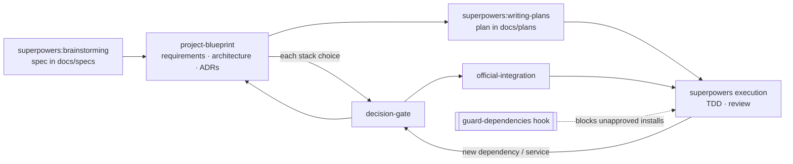

# senior-standards — Design

- **Status:** Draft, awaiting review
- **Date:** 2026-10-21
- **Author:** kling.gaetan@gmail.com (with Claude)
- **Type:** Claude Code plugin, companion to Superpowers v6.4.x

## 1. Intent

### What the user asked for
- A clear plan before each project, with written documentation of the product, the architecture and the decisions.
- Use established libraries instead of hand-rolled code (example: Better Auth for auth), and pull in the vendor's MCP servers and Agent Skills.
- Always ask before introducing a dependency, service, database, hosting provider or paid API, with the options, their differences and benefits laid out.
- Always install the vendor's official way (documented command, official CLI, official skill or MCP).
- Clean repositories, good documentation, best practices, best architecture. The user is a senior developer: output should be dense and precise, not tutorial-style.

### Assumptions (to confirm in review)
- **A1.** Superpowers stays installed and keeps owning the process (brainstorming → spec → writing-plans → TDD → review). This plugin adds rules and steps; it does not replace any Superpowers skill.
- **A2.** The primary stack is TypeScript/Node. Other ecosystems get the decision gate and the install guard, but no repo-standards profile in v1.
- **A3.** The user works mostly on Windows in the Claude desktop app, so all hook code must run cross-platform. Hooks are written in Node (already required for the target stack), not bash.
- **A4.** "Always ask" applies to *runtime and dev dependencies*, *external services*, *databases*, *hosting* and *paid APIs*. It does not apply to transitive dependencies or to reinstalling from an existing lockfile.

### Success criteria
1. On a new project, no product code or install happens before `requirements.md`, `architecture/overview.md` and the ADRs for every stack choice exist and the user has approved them.
2. Every new direct dependency is either covered by an accepted ADR or triggers a confirmation prompt, even when the model forgets the skill.
3. Every choice of service, DB, host or paid API is presented as a comparison of 2–4 options with a recommendation, then recorded as an ADR.
4. Every install uses the command from the vendor's current docs, and the vendor's MCP server and skills (when they exist) are proposed at project scope.
5. Upgrading Superpowers does not break or remove any of the above.

## 2. Non-goals
- Replacing or forking any Superpowers skill.
- Detecting service, DB or hosting choices mechanically. Those are enforced by the skill and the session rules only, since no tool call reliably signals them.
- Gating `npx`/`pnpm dlx`/`bunx` one-off executions in v1 (official scaffolders and CLIs are run this way, and gating them would add friction for no safety gain).
- Stack profiles other than TypeScript/Node in v1.
- Publishing to a public marketplace.

## 3. Approach

A companion plugin, `senior-standards`, in its own git repository that is also a single-plugin marketplace. It is installed alongside Superpowers.

Rejected alternatives:
- **Fork Superpowers:** full control, but every upstream release needs a manual merge.
- **Global `~/.claude/CLAUDE.md` only:** no enforcement, rules are diluted in long sessions, and it can't ship templates or hooks.

## 4. Architecture

### 4.1 Repository layout

```text
senior-standards/                      # git repo = marketplace root
├── .claude-plugin/
│   └── marketplace.json               # one entry: senior-standards → ./plugin
├── plugin/
│   ├── .claude-plugin/plugin.json
│   ├── hooks/
│   │   ├── hooks.json
│   │   ├── session-start.mjs          # injects the standards
│   │   ├── guard-dependencies.mjs     # PreToolUse install/manifest guard
│   │   └── lib/                       # pure functions, unit-tested
│   │       ├── parse-install.mjs      # command → {manager, packages[]}
│   │       ├── diff-manifest.mjs      # package.json before/after → added deps
│   │       └── adr-index.mjs          # docs/adr/*.md → approved package set
│   ├── standards/
│   │   └── standards.md               # the text session-start injects
│   └── skills/
│       ├── project-blueprint/
│       │   ├── SKILL.md
│       │   └── templates/             # README, requirements, architecture, ADR, CONTRIBUTING, CLAUDE.md
│       ├── decision-gate/SKILL.md
│       ├── official-integration/SKILL.md
│       └── repo-standards/
│           ├── SKILL.md
│           └── profiles/typescript-node.md
├── tests/                             # node:test, zero dependencies
├── docs/
│   ├── specs/                         # this file
│   ├── plans/
│   └── adr/                           # the plugin's own decisions
├── README.md
├── CHANGELOG.md
└── LICENSE
```

The plugin itself has **zero runtime dependencies**: Node built-ins only. This keeps the guard fast, avoids installing anything into `${CLAUDE_PLUGIN_DATA}`, and practices the rule it enforces.

### 4.2 Components

| Unit | Trigger | Responsibility | Depends on |
|---|---|---|---|
| `session-start.mjs` | SessionStart (`startup\|clear\|compact`) | Emits `standards.md` as `additionalContext`. | `standards/standards.md` |
| `standards.md` | — | The always-on rules (§5). Short: under ~60 lines, so it stays effective next to Superpowers' own injection. | — |
| `guard-dependencies.mjs` | PreToolUse, matcher `Bash\|Edit\|Write` | Detects new direct dependencies; returns `ask` unless an accepted ADR covers every one of them (§6). | `lib/*` |
| `project-blueprint` | After a brainstorming spec is approved, before writing-plans | Produces the project documentation set (§7) from templates and gets it approved. | `decision-gate` |
| `decision-gate` | Any new dependency, service, database, host or paid API | Comparison → recommendation → user choice → ADR (§8). | — |
| `official-integration` | After a decision is accepted, before the install | Official docs lookup, official install, vendor MCP/skills proposal (§9). | — |
| `repo-standards` | Project bootstrap, or user request on an existing repo | Applies the TS/Node baseline as one bundled decision (§10). | `decision-gate` |

### 4.3 How it plugs into Superpowers



Hand-off points use Superpowers' documented extension point: its skills state that user preferences override default locations and steps. `standards.md` therefore states, as user preferences:
- Specs go to `docs/specs/`, plans to `docs/plans/` (instead of `docs/superpowers/...`).
- On the architectural path, after the spec is approved and before invoking writing-plans, run `senior-standards:project-blueprint`.

No Superpowers file is modified.

## 5. Always-on standards (`standards.md`)

Content outline (final wording written in the plan):
1. **Decision rule.** Never introduce a dependency, external service, database, hosting provider or paid API without `senior-standards:decision-gate`. Applies to existing repos too.
2. **Prefer established libraries.** Before writing infrastructure code (auth, payments, email, queues, validation, ORM, date handling, i18n…), check for a mature library and present it through the decision gate. Custom code is one of the options, never the silent default.
3. **Official installation only.** Installs follow `senior-standards:official-integration`. No hand-edited dependency versions in manifests; the package manager writes them.
4. **Documentation locations** (§4.3) and the blueprint step.
5. **Repo hygiene:** Conventional Commits; small, single-purpose modules; no dead code, commented-out code or stray TODOs; docs updated in the same change as the code they describe; ADRs are append-only (supersede, never edit an accepted one).
6. **Communication:** the user is a senior developer. Be concise, give trade-offs and reasoning, skip basics.

## 6. Dependency guard (hook)

### 6.1 Detection

**Bash:** `parse-install` recognises, per manager, the commands that *add* a direct dependency, and extracts package names (stripping version specifiers and flags):

| Manager | Commands |
|---|---|
| npm | `npm install\|i\|add <pkg…>` |
| pnpm | `pnpm add <pkg…>` |
| yarn | `yarn add <pkg…>` |
| bun | `bun add <pkg…>` |
| Python | `pip install <pkg…>` (not `-r`/`-e .`), `uv add`, `poetry add` |
| Rust / Go / PHP / .NET | `cargo add`, `go get`, `composer require`, `dotnet add package` |

Not gated: lockfile installs with no package arguments (`npm install`, `pnpm install`, `npm ci`, …), removals, and `npx`-style one-off runs. Chained commands (`&&`, `;`, `|`) are split and each segment is checked.

**Edit|Write:** only `package.json` in v1. The hook rebuilds the post-edit file (Write: `content`; Edit: apply `old_string`→`new_string` to the current file), diffs `dependencies`, `devDependencies`, `peerDependencies` and `optionalDependencies`, and gates added names. Any other manifest (`pyproject.toml`, `Cargo.toml`, `go.mod`…) gets `ask` whenever the edit touches it, since v1 does not parse them.

### 6.2 Approval source

`adr-index` reads `docs/adr/*.md` under `${CLAUDE_PROJECT_DIR}` and collects the `packages` list from the frontmatter of every ADR with `status: accepted`:

```yaml
---
status: accepted          # proposed | accepted | superseded | rejected
date: 2026-10-21
packages: [better-auth]   # exact names the decision approves; may be empty
---
```

### 6.3 Decision

- Every detected package is in the approved set → no output; the normal permission flow continues (the hook never returns `allow`, so it can't widen permissions).
- Otherwise → `permissionDecision: "ask"` with a reason naming the uncovered packages, e.g. `New dependency not covered by an accepted ADR: zod, date-fns. Run the decision gate first, or approve to proceed anyway.`
- Any internal error (unparseable JSON, unreadable ADR) → `ask` with the error in the reason. The guard fails closed but never blocks outright: the user always keeps the final word.

### 6.4 Hook registration

`hooks.json` uses exec form, so paths with spaces need no quoting and nothing depends on bash being present:

```json
{
  "hooks": {
    "SessionStart": [{ "matcher": "startup|clear|compact",
      "hooks": [{ "type": "command", "command": "node", "args": ["${CLAUDE_PLUGIN_ROOT}/hooks/session-start.mjs"] }] }],
    "PreToolUse": [{ "matcher": "Bash|Edit|Write",
      "hooks": [{ "type": "command", "command": "node", "args": ["${CLAUDE_PLUGIN_ROOT}/hooks/guard-dependencies.mjs"] }] }]
  }
}
```

The exact exec-form field names are verified against the hooks reference while writing the plan.

## 7. `project-blueprint` skill

Produces, from templates in `templates/`, and only what is missing:

| File | Content |
|---|---|
| `README.md` | One-paragraph purpose, quick start, scripts, links into `docs/`. |
| `docs/product/requirements.md` | Problem, users, goals, **non-goals**, functional requirements, non-functional requirements (performance, security, availability, compliance), constraints, success metrics. |
| `docs/architecture/overview.md` | arc42-lite: context and scope (C4 level 1, Mermaid), building blocks (C4 level 2), key runtime flows (sequence diagrams), deployment view, cross-cutting concerns (authn/z, errors, logging, config, i18n), quality goals, risks and technical debt. |
| `docs/adr/0001-record-architecture-decisions.md` | Bootstraps the ADR log. Format: MADR (context, options, decision, consequences) plus the §6.2 frontmatter. |
| `docs/adr/NNNN-*.md` | One per stack decision, written by `decision-gate`. |
| `CONTRIBUTING.md` | Branching, commit convention, how to run checks, how to add an ADR. |
| `CLAUDE.md` | Short project memory: stack, commands, layout, links to the docs above. No duplicated content. |

Flow:
1. Read the approved spec.
2. Draft `requirements.md` and present it for approval.
3. List the stack decisions the architecture needs (e.g. framework, database, auth, hosting) and run `decision-gate` for each, one at a time.
4. Draft `architecture/overview.md` from the spec, requirements and accepted ADRs; present it for approval.
5. Write the remaining files, commit them as `docs: project blueprint`, and hand off to `superpowers:writing-plans`.

Existing repos: the skill runs only on request, and then only fills missing documents (it never rewrites existing ones without asking).

## 8. `decision-gate` skill

1. **Frame the decision:** what is needed, the constraints from `requirements.md`, and whether it is a dependency, service, database, host or paid API.
2. **Research current facts** from official sources (pricing pages, docs, release history, license). No pricing or maturity claims from memory.
3. **Present 2–4 options** in a table. "Build it ourselves" is a row only when it is realistic:

   | Criterion | Option A | Option B | … |
   |---|---|---|---|
   | Fit for the requirements | | | |
   | Maturity and maintenance (release cadence, maintainers, adoption) | | | |
   | License | | | |
   | Cost now and at scale | | | |
   | Lock-in and exit cost | | | |
   | Security and compliance posture | | | |
   | DX and type safety | | | |
   | Official AI tooling (MCP server, skills, llms.txt) | | | |

4. **Recommend one option** with the deciding reasons, then ask with `AskUserQuestion`, with the recommended option first.
5. **Write the ADR** (`status: accepted`, `packages:` filled in) only after the answer; a rejected recommendation is recorded in the ADR's "Considered options".
6. Hand off to `official-integration`.

Batched decisions: tightly coupled choices (e.g. the repo tooling baseline, §10) can be one decision and one ADR listing every package, to avoid a prompt per lint plugin.

## 9. `official-integration` skill

1. **Find the official source:** the vendor's docs site and its `llms.txt` if present. A documentation MCP is used when the project has one configured.
2. **Install with the documented command,** translated to the project's package manager (e.g. `pnpm add better-auth`; the package is `better-auth`, not `betterauth`). Exact package names are always checked against the docs, never guessed.
3. **Run the vendor's official CLI or generators** where the docs prescribe them (schema generation, migrations, init), rather than hand-writing their output.
4. **Vendor AI tooling:** check the docs for an official MCP server and Agent Skills. Example: Better Auth documents a docs MCP server at `https://mcp.better-auth.com/mcp` and publishes skills at `/docs/ai-resources/skills`. Propose adding them **at project scope** (`.mcp.json`, `.claude/skills/`), using the vendor's documented install method. This changes persistent config, so it is a question to the user, never automatic.
5. **Record:** link the docs page and any MCP or skill added in the ADR, and list project MCP servers in `CLAUDE.md`.

## 10. `repo-standards` skill (TypeScript/Node profile)

Presented as one bundled decision (one ADR) with the recommended default per row and the main alternative:

| Concern | Recommended default | Main alternative |
|---|---|---|
| Package manager | pnpm | npm, bun |
| Language | TypeScript `strict`, `noUncheckedIndexedAccess` | — |
| Lint + format | Biome | ESLint + Prettier |
| Tests | Vitest | node:test |
| Commits | Conventional Commits, commitlint + lefthook | husky |
| Releases | Changesets (libraries) / none (apps) | release-please |
| Env config | Typed, validated env module (zod) | t3-env |
| CI | GitHub Actions: install, lint, typecheck, test, build | — |
| Dependency updates | Renovate | Dependabot |
| Editor | `.editorconfig`, `.gitattributes` | — |

Recommendations are re-checked against current releases when the skill runs; the table is a starting point, not pinned truth. Architecture layout (feature-sliced vs layered vs hexagonal) is chosen in `project-blueprint`, not here.

## 11. Error handling

- Hooks never throw to Claude Code: every path returns valid JSON or no output. Errors become `ask` with a reason (§6.3).
- SessionStart: if `standards.md` is unreadable, emit a one-line warning as context instead of failing the session.
- Skills: if official docs can't be reached, say so and stop before installing, rather than falling back to memory.

## 12. Testing

- **Unit (node:test, no dependencies):** `parse-install` over a table of real commands, including chained commands, flags, version specifiers, scoped packages and lockfile-only installs; `diff-manifest` for Write and Edit; `adr-index` for status filtering and malformed frontmatter.
- **Hook contract:** run each hook script with fixture stdin and assert the exact JSON output.
- **Validation:** `claude plugin validate ./plugin --strict` in CI.
- **Scenario check (manual, documented in README):** in a throwaway "Next.js app with auth" project:
  1. The blueprint docs are produced before any code.
  2. Auth goes through the decision gate, Better Auth appears as a compared option, and an ADR is written.
  3. `pnpm add better-auth` passes without an extra prompt after the ADR; `pnpm add lodash` prompts.
  4. The Better Auth MCP server and skills are proposed, not silently added.

## 13. Installation (for the user)

```bash
claude plugin marketplace add <path-or-git-url-of-this-repo>
claude plugin install senior-standards@senior-standards
```

Superpowers is not declared in `dependencies`: it lives in another marketplace, and a cross-marketplace dependency would make installs fail if it is ever renamed there. The README states it as a requirement instead.

## 14. Open questions for review
1. **Context7 MCP.** Bundling it would give every session live, versioned docs for most libraries. It's a third-party service (Upstash), so by this plugin's own rule it needs your call: bundle it, or rely on each vendor's own docs MCP and `llms.txt` per project?
2. **Plugin name.** `senior-standards` is a working name.
3. **Repo home.** Local only for now, or a private GitHub repo so the marketplace can be added from a URL on other machines?
4. **Defaults in §10.** Biome vs ESLint+Prettier and pnpm vs npm are the two choices most worth your opinion.
