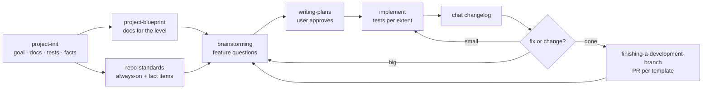

# senior-standards v0.2.0: project flow — Design

- **Status:** Draft (2026-11-14), awaiting approval.
- **Builds on:** [v0.1.0 design](2026-10-21-senior-standards-design.md). Everything there stays unless this document changes it.

## 1. Intent

The user wants one predictable lifecycle for every project, sized to the project:

1. **Init**: agree on the project's goal and how much documentation, testing and protection it needs.
2. **Feature planning**: clarify the feature with thorough questions, then write a plan the user approves.
3. **Implementation**, ending with a changelog in chat: what changed and why.
4. **Fixes and modifications**: small ones directly, big ones back through planning, each ending with a chat changelog.
5. **Feature end**: a well-written PR, then the next feature.

Why: the user is a senior developer who wants control over every decision, a repository others can work in, and no ceremony a project does not need. Rigour should scale with the project, not be the same for a one-shot website and a maintained library.

Most of the lifecycle already exists in Superpowers 7.0.2 and senior-standards v0.1.0. This version fills the gaps and does not reimplement what exists.

### What already exists (not rebuilt)

| Step | Existing piece |
|---|---|
| Clarify a goal or a feature | `superpowers:brainstorming` |
| Plan; user approves | `superpowers:writing-plans` |
| Implement | `superpowers:subagent-driven-development` or `superpowers:executing-plans` |
| Open the PR | `superpowers:finishing-a-development-branch` (follows the repository's PR template) |
| Small vs big change | `brainstorming` sizes work as "small change" or "project" |
| Docs and stack decisions | `project-blueprint`, `decision-gate`, `adr` |
| Repository tooling | `repo-standards`, `audit` |
| Controlled dependencies, ask first | `decision-gate`, the dependency guard |
| Conventional Commits, no AI attribution | `core/standards.md`, checklist V2 |

### Gaps this version fills

1. No init step that records how much docs, testing and protection the project needs.
2. Superpowers forces test-first everywhere, whatever the project.
3. Superpowers 7 asks one open question at a time with no options; the user wants every question with context and described options.
4. No changelog in chat after implementation or fixes.
5. No rule on PR content beyond the repository template.
6. No rule for branch `main` or for English.
7. No workflow guide in the README.

## 2. Goals, non-goals, anti-goals

**Goals**
- A `project-init` skill that sets the project goal, docs level, test extent and protection facts, and records them in `AGENTS.md`.
- Existing skills and rules follow that record.
- The rules above (questions, chat changelog, PR, `main`, English) in the always-on standards.
- A session-start reminder when a repository has no setup record.
- A README section on how to use the workflow.
- Works for collaborators who do not have senior-standards installed (§9).

**Non-goals**
- Rewriting or forking any Superpowers skill.
- Writing the chat changelog to a file.
- Supporting forges other than GitHub for the automated settings (the record and the files stay forge-neutral; §10).

**Anti-goals** (failure even if it works)
- Ceremony on small projects: a one-shot website must not get Renovate, CodeQL or a `dev` branch.
- Anything that only binds people who run the plugin. Rules that matter are enforced by the repository (CI, rulesets), not by the agent.
- Repeating a Superpowers skill's content inside a senior-standards skill.

## 3. Approaches

| Approach | Trade-off | Decision |
|---|---|---|
| **1. New `project-init` skill, plus a session-start reminder** | Fits the plugin's one-skill-per-step shape; the reminder makes init hard to skip; costs one new skill and changes to two existing ones | **Chosen** by the user |
| 2. Init as the first phase of `repo-standards` | Less surface, but one skill both decides the project's shape and installs tools; docs level and test extent are not tooling, and `project-blueprint` would depend on `repo-standards` | Rejected |
| 3. Everything in the always-on standards text | Simplest; but the text loads into every session of every project long after init, and a long checklist there is followed less reliably than a skill | Rejected |

## 4. The flow



## 5. `project-init` skill

### 5.1 When it runs

- A new project, before the first feature is planned.
- A repository whose `AGENTS.md` has no setup record (§5.4), when the user starts planning or asks for it; the session-start reminder (§8) prompts this.
- The user asks to change one setting ("switch tests to strict", "this repo is now public"). Only that item is re-asked and re-applied.

### 5.2 Steps

1. **Read the state.** Existing `AGENTS.md`, README, CI workflows, rulesets (through the GitHub CLI when available), hooks, test setup, `docs/`. In an existing repository, propose the levels that match what is already there.
2. **Goal.** If an approved spec or a README already states the goal, confirm it in one line. Otherwise run `superpowers:brainstorming` for the project goal only (who it is for, what success is, what it is not); features come later.
3. **Ask the setup questions in one message** (question style, §6.1). Each option says exactly what it turns on:
   - **Docs** — Basic (README, `AGENTS.md`, `CONTRIBUTING.md`, decision records) or Full (Basic plus requirements and architecture docs from `project-blueprint`). No middle level: decision records are required at every level because the dependency guard approves packages only through them.
   - **Tests** — Light (CI build plus tests on the critical paths), Standard (tests written with each feature), Strict (test-first, coverage threshold enforced in CI).
   - **Will the repo be public? (CodeQL code analysis, secret scanning with push protection, OpenSSF Scorecard, `SECURITY.md`)** — GitHub provides these free only on public repositories.
   - **Will it be maintained over time? (Renovate dependency updates, dependency audit in CI)**
   - **Versioned releases? (a `dev` branch with release PRs `dev` → `main`, release tooling, tags, generated release notes)**
4. **Show what it will do**, as a list grouped by always-on and per-answer items, and stop for approval.
5. **Write the record** (§5.4) into `AGENTS.md` (create the file from the `project-blueprint` template if missing) and commit `chore: record project setup`.
6. **Hand off**: `project-blueprint` for the docs level, then `repo-standards` for the always-on and fact-gated items. Each keeps its own approval stops and runs `decision-gate` for every tool (for example the hook manager and the release tool).

### 5.3 What each answer turns on

| Setting | Effect |
|---|---|
| Always | Feature branches; PRs into the integration branch; ruleset R1 on `main` (and on `dev` when Versioned is yes); CI builds and runs the tests that exist, as required checks (§5.7); gitleaks as a pre-commit hook and in CI (the gitleaks half of S1); Conventional Commits on PR titles (V2); PR template (§6.3); `CONTRIBUTING.md` workflow section; least-privilege workflows S3; pins and frozen installs D3; one `check` entry point R5; `.editorconfig` and line endings R4; error-handling and validation conventions A2; docs checks C1 and ADR index C2 |
| Docs: Basic | `project-blueprint` writes README, `AGENTS.md`, `CONTRIBUTING.md`, ADR 0001 and the stack ADRs; skips requirements and architecture |
| Docs: Full | Full `project-blueprint` flow (v0.1.0 §7) |
| Tests: Light | No test-first; tests for critical paths only; CI runs build and tests |
| Tests: Standard | Tests written with each feature, in the same change; no test-first requirement; coverage reported, not enforced |
| Tests: Strict | `superpowers:test-driven-development` applies; coverage threshold on changed code in CI (T1) |
| Public: yes | S2 CodeQL (default setup), the GitHub-native half of S1 (secret scanning and push protection), S5 Scorecard, S4 `SECURITY.md` |
| Maintained: yes | D1 Renovate, dependency audit in CI (the ecosystem's audit tool, chosen through `decision-gate`), lockfile maintenance |
| Versioned: yes | `dev` integration branch covered by R1; feature PRs into `dev`; release PRs `dev` → `main`; V1 versioning scheme, V3 release tool, V4 changelog and tags |
| Versioned: no | Feature PRs straight into `main`; no `dev` |

Items in checklist part 3 (A3, R3, R6, C3, T2, D5) are still offered once by `repo-standards` when they apply; they are not init questions. Checklist A1 (layer rules in CI) applies only at Docs `full`, where the architecture document defines the layers. T1 applies only at Tests `strict`.

A private repository on a plan that includes GitHub's code security features can turn the Public items on as overrides (§5.6); the init question stays about public repositories, since that is the free case.

### 5.4 Setup record

A section in `AGENTS.md`, plain Markdown so any person or agent can read it, with one marker line so tools can find it:

```markdown
## Project setup

<!-- senior-standards:setup v1 -->
- Goal: <one or two sentences>
- Docs: basic
- Tests: standard
- Public repository: no
- Maintained over time: yes
- Versioned releases: no
- Overrides: none
- Recorded: 2026-11-14
```

- Lives in `AGENTS.md` at the repository root (the Git top-level directory; the directory itself when there is no Git repository yet).
- Values are lowercase from fixed sets (`basic|full`, `light|standard|strict`, `yes|no`). The integration branch is derived, not recorded: `dev` when Versioned releases is `yes`, otherwise `main`.
- `Overrides` lists checklist items turned on or off against the defaults, by ID with a reason (for example `S2 on: GitHub Advanced Security available`), or `none`.
- `v1` versions the format so later releases can migrate it. Changing a value goes through `project-init` (§5.6), which updates the line and the date.

### 5.5 Existing repositories (builder's call)

Step 1 proposes values from what exists; the user confirms or changes them:

| Setting | Proposed as |
|---|---|
| Docs | `full` when both requirements and architecture documents exist, else `basic` |
| Tests | `strict` when CI enforces a coverage threshold; `standard` when tests exist beside most source modules; else `light` |
| Public | From the repository's visibility on the forge |
| Maintained | `yes` when Renovate or Dependabot config exists |
| Versioned | `yes` when tags matching `v*` or a release tool config exist |

Nothing already in the repository is removed because the record does not call for it; `project-init` lists such items and asks per item.

### 5.6 Changing a setting (builder's call)

`project-init` re-asks only the changed item, shows what will be added and what would be removed, updates the record, then hands the item list to `repo-standards` (§7, item mode), which applies it with its usual per-setting approvals. `project-init` never changes repository settings or branches itself. Removals are proposed, never automatic: for Versioned `yes` → `no`, it proposes merging `dev` into `main`, retargeting open PRs to `main`, then deleting `dev` and its ruleset, each step asked.

### 5.7 Required checks without tests (builder's call)

The `check` entry point and CI succeed when the project has no tests yet (build and lint still run). Required status checks are added to the ruleset only after the CI workflow has reported once on a PR, so a never-reporting check cannot block every PR. `repo-standards` orders the work accordingly.

## 6. Always-on standards additions (`core/standards.md`)

The additions stay short, about 25 lines in total, since the file loads into every session.

### 6.1 Questions

> When you need decisions from the user, ask all the questions for the current stage in one message, numbered. Give each its context (why it matters, what it changes), the options with a short description and trade-offs each, and your recommendation. Use an open question only when the options cannot be named yet. This replaces any skill default of one question at a time or questions without options.

This overrides Superpowers 7 `brainstorming`'s one-open-question style through the user-instructions-over-skills rule. The rest of `brainstorming` (approaches, written design, approval gate) is unchanged.

### 6.2 Chat changelog

> After implementing a plan, a fix or a modification, end with a changelog in chat: what changed, why, the files touched, how it was verified (commands and results), and what is not done or not verified. It is for the user only; do not write it to a file.

### 6.3 Pull requests

> PR titles follow Conventional Commits. The description follows the repository's PR template; where there is none: summary, motivation, changes, how it was tested, risks and rollback, linked issues and ADRs. Write it for a reviewer, not as a commit log.

The PR template shipped by `repo-standards` (and used by this repository) gets those sections.

### 6.4 Branches and language

> The default branch is `main`, never `master`; create repositories with `git init -b main` (or the forge's equivalent). Work on feature branches named `<type>/<short-topic>`; merge through PRs.
>
> Code, identifiers, comments, commit messages, PRs, issues and documentation are in English, whatever language the conversation is in.

### 6.5 Tests and setup record

> The project's `AGENTS.md` setup record (`## Project setup`) sets the docs level, test extent and protection items; follow it. `superpowers:test-driven-development` applies only when Tests is `strict`; at `standard`, write tests in the same change as the feature; at `light`, test the critical paths. If there is no setup record, run `project-init` (`senior-standards:project-init`) before planning the first feature.

## 7. Changes to existing skills

- **`project-blueprint`**: read the setup record. At Docs `basic`, skip the requirements and architecture stages (steps 2 and 4); the stack decisions (step 3) and the remaining files still run. At `full`, unchanged. Without a record, ask the docs question first.
- **`repo-standards`**: split checklist part 2 into "always" and "fact-gated" per §5.3 (S1 splits into gitleaks, always, and GitHub-native scanning, Public); read the record and propose only the matching items, plus overrides. New **item mode**: given a list of checklist IDs from `project-init`, apply only those. The PR template it writes uses §6.3's sections. When Versioned is `yes`, R1 covers `main` and `dev`. Order per §5.7.
- **`audit`**: report drift between the setup record and the repository, one check per row of §5.3 (for example Maintained `yes` → Renovate config present and an audit step in CI; Public `yes` → CodeQL enabled; Versioned `yes` → `dev` exists with a ruleset; Tests `strict` → coverage threshold in CI; Docs `full` → requirements and architecture docs present). A missing setup record is itself a finding.
- **`decision-gate`**: unchanged. Its question format already matches §6.1.

## 8. Session-start reminder

When the session's working directory is inside a project (a Git repository, or a directory with a manifest `core/manifests` recognises) and the root `AGENTS.md` (§5.4) has no `senior-standards:setup` marker, append one line to the injected standards. An empty or non-project directory gets no reminder; for a new project, the §6.5 rule sends the agent to `project-init`. The reminder line is:

> This repository has no project setup record. Before planning features, run `project-init`.

- **Core**: a new `core/setup-record.mjs` with `readSetupRecord(dir)` → `{ found, values, problems }`, reading at most the first 256 KB of `<dir>/AGENTS.md`. Invalid values are reported as `problems` and the reminder names them.
- **Claude Code**: `session-start.mjs` reads the hook input's `cwd` from stdin. SessionStart runs once, so the reminder stays in context after the record is written; `project-init` ends by telling the agent the record now exists and the reminder no longer applies.
- **OpenCode**: the context hook uses `ctx.location.directory` and reads the record on each turn (a small file read), so the reminder disappears once the record exists.
- Errors never escape: on any failure, inject the standards without the reminder.

## 9. Collaborators without the plugin

Principle: **the plugin decides and generates; the repository enforces.** Everything binding lives in files and settings any contributor meets, whatever tools they use.

| Concern | Enforced by | Works without the plugin? |
|---|---|---|
| PRs only into `main`, required CI | GitHub ruleset, CI workflows | Yes |
| Build and tests pass | CI | Yes |
| Secrets | gitleaks in CI (hook is an early warning) | Yes; the hook needs a one-time install documented in `CONTRIBUTING.md` |
| Conventional Commit PR titles | CI (V2) | Yes |
| PR content | `.github/pull_request_template.md` | Yes |
| Workflow, branches, English, test extent | `CONTRIBUTING.md` and `AGENTS.md` (read by most coding agents) | Yes, as written guidance |
| New dependencies need a decision record | The plugin's guard, and code review | Only with the plugin today; see proposal P1 |

Rules for generated files:
- No CI step, script or config may require senior-standards to be installed.
- The setup record, ADRs and templates are plain Markdown; nothing depends on `.claude/` or `.opencode/`.
- `CONTRIBUTING.md` (written by `project-blueprint` at every docs level) describes the workflow for humans: branches, PR into the integration branch, Conventional Commits, English, test extent, how to install the hook, and that new dependencies come with an ADR.

## 10. README: how to use the workflow

A new section, "Working with senior-standards", one row per stage: what to say, which skill takes over, what you approve. Example rows: "Start a new project" → `project-init`; "Let's plan <feature>" → `brainstorming` then `writing-plans`; "Go" after a plan → implementation and the chat changelog; "Fix <issue>" → direct fix or back to planning; "Open the PR" → `finishing-a-development-branch`. It says plainly that no slash commands are needed, and how to name a skill explicitly if one does not trigger.

## 11. Proposed additions (each needs the user's yes)

- **P1. Dependency-ADR check in CI.** A small check that fails a PR adding a dependency no accepted ADR lists, so the rule binds collaborators too. Trade-off: the check must run without the plugin installed, so it is either a script copied into the project (zero dependencies, vendored from `core/`) or a published package; vendoring keeps "no plugin needed" but must be updated by hand.
- **P2. Branch hygiene in the guard.** Ask before `git init` without `-b main` when `init.defaultBranch` is not `main`, and before a direct `git push` to `main`. Low cost; the ruleset already blocks the push on GitHub, so this mainly helps before the remote exists.
- **P3. Release PR description.** For `Versioned: yes`, a release PR template listing the feature PRs included since the last release.
- **P4. Evals** for init (questions with effects shown, record written) and the chat changelog.
- **P5. OpenCode subagents** get the standards too (a v0.1.0 known limitation), so their work follows the record.

## 12. Testing

- `core/setup-record.mjs`: unit tests for found/missing marker, every value set, invalid values, CRLF, BOM, oversize file, missing file.
- Adapters: session-start tests with and without a record, with a bad `cwd`, and with a reader error (standards still injected).
- `tests/skills/format.test.mjs` covers the new skill automatically.
- A standards test asserting the §6 rules are present.
- Evals only if P4 is accepted.

## 13. Versioning and documents

- Version 0.2.0 (new features, no breaking change).
- ADR 0005 (0001 to 0004 exist): the setup record format and its location in `AGENTS.md`, with a separate file (`.senior-standards.yml`) recorded as rejected because collaborators and other agents already read `AGENTS.md`.
- Update README (skills table, workflow section), CHANGELOG, `AGENTS.md`, and the v0.1.0 spec's skill list through a link to this document.

## 14. Left to the builder

- Wording of the skill and standards text, within §5 and §6.
- How `project-init` reads existing rulesets and visibility (GitHub CLI when present; otherwise ask). Naming the GitHub CLI in the skill is fine: automated settings are GitHub-only (§2).
- Test fixtures and file layout inside `skills/project-init/`.
