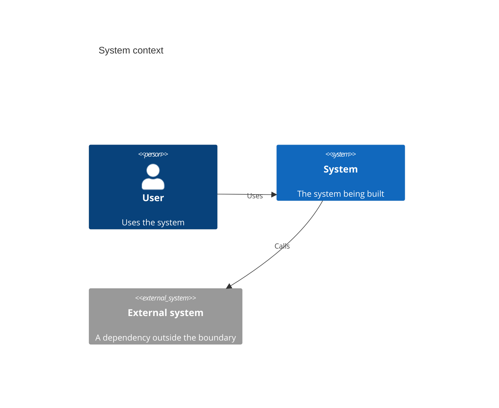
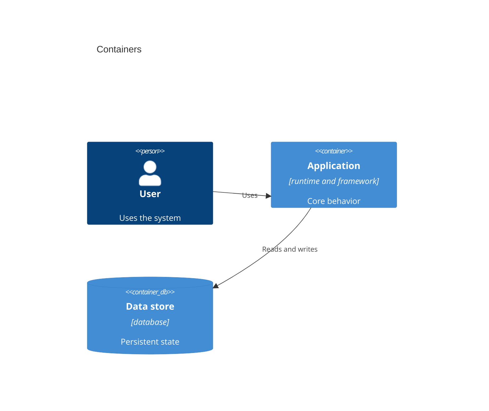
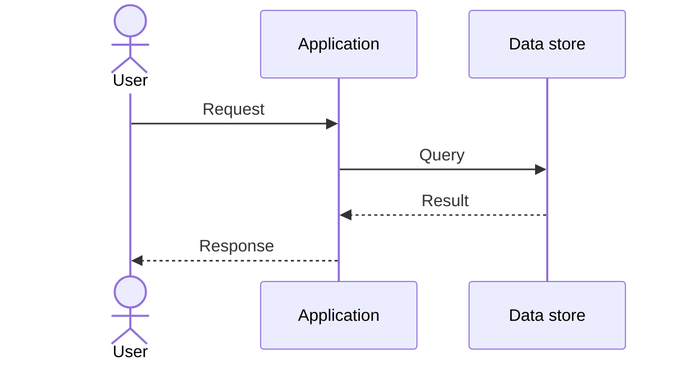
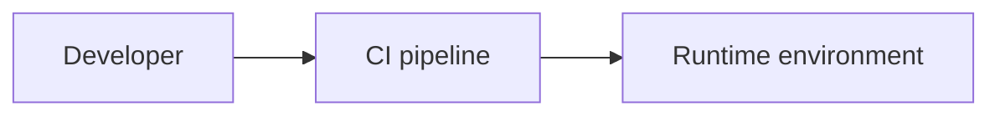

# Architecture overview

<!-- Structure follows arc42-lite. Status: draft until the user approves. -->

## 1. Context and scope

<!-- fill: the system boundary, its users and the external systems it talks to. -->

<!-- fill: one paragraph per external actor and interface. -->

## 2. Solution strategy

<!-- fill: the chosen architecture style (layered, hexagonal, feature-sliced or clean) and why, the key technology choices, and the ADRs that record them. -->

## 3. Building blocks

<!-- fill: the containers and their responsibilities. -->

<!-- fill: a short table of containers with responsibility, technology and owning ADR. -->

## 4. Runtime view

<!-- fill: one sequence diagram per key flow (the main user journey, authentication, a failure path). -->

## 5. Deployment view

<!-- fill: environments, hosting, network zones, how a build reaches each environment, rollback. -->

## 6. Cross-cutting concerns

<!-- fill: state the strategy and the library or service chosen (with ADR link) for each. -->

- Authentication and authorization: <!-- fill -->
- Error handling: <!-- fill: one strategy; validate only at I/O boundaries. -->
- Logging and observability: <!-- fill: logs, metrics, tracing, error tracking. -->
- Configuration and secrets: <!-- fill: where configuration lives, how secrets are injected and rotated. -->
- Internationalization: <!-- fill: locales and formats, or "not applicable". -->

## 7. Architecture decisions

Decisions are recorded as ADRs; see the [decision index](../adr/README.md).

## 8. Quality goals

<!-- fill: the top three to five quality attributes in priority order, each with a scenario and a measurable target. -->

| Priority | Quality goal | Scenario and target |
|---|---|---|
| 1 | <!-- fill --> | <!-- fill --> |

## 9. Threat model

<!-- fill: keep it lightweight and revisit it when the architecture changes. -->

### Assets

<!-- fill: data and capabilities worth protecting, with their sensitivity. -->

### Trust boundaries

<!-- fill: where trust changes: client to server, service to service, service to third party, public to admin. -->

### Top threats

<!-- fill: the most likely or most damaging threats, for example by STRIDE category. -->

| Threat | Asset or boundary | Likelihood and impact |
|---|---|---|
| <!-- fill --> | <!-- fill --> | <!-- fill --> |

### Mitigations

<!-- fill: one mitigation per threat above, and where it is implemented or verified. -->

## 10. Layer rules

<!-- fill: the allowed dependency directions between layers or modules. CI enforces these (dependency-cruiser, import-linter, ArchUnit, NetArchTest or an equivalent for the stack); a violation fails the build. -->

| Layer or module | May depend on | Must not depend on |
|---|---|---|
| <!-- fill --> | <!-- fill --> | <!-- fill --> |

Enforcement: <!-- fill: the tool and the `check` step that runs it. -->

## 11. Risks and technical debt

<!-- fill: known risks and accepted debt, each with an owner and a trigger for revisiting. -->

| Item | Kind (risk or debt) | Mitigation or plan |
|---|---|---|
| <!-- fill --> | <!-- fill --> | <!-- fill --> |
